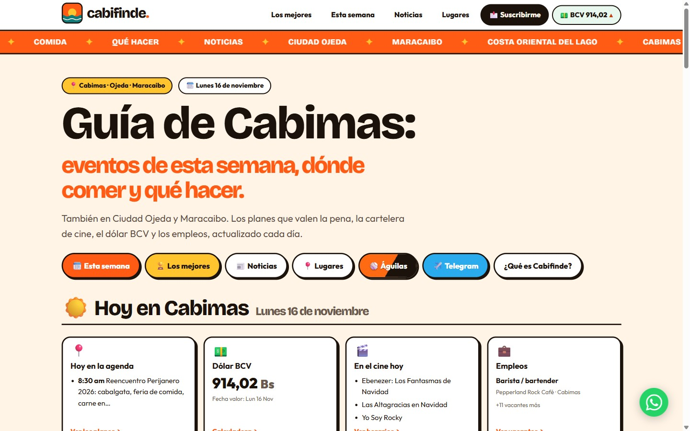
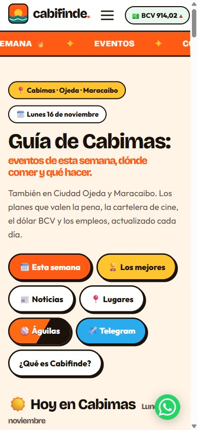

    

  
  &nbsp;
  

## Qué es

Una guía de Cabimas (Zulia, Venezuela): planes de la semana, agenda de eventos, los mejores lugares «según Google», cartelera de cine, dólar BCV, empleos y un directorio de negocios. Es un proyecto propio de Prisma Develop.

## Qué se hizo

- **Tema de WordPress hecho desde cero**, sin constructores de páginas. Carga rápido y cada sección se edita sin tocar el diseño.
- **Contenido que se actualiza solo**: tasa del dólar, cartelera de cine y agenda de la semana.
- **Bot de Telegram y canal** con avisos y planes, y un **correo cada jueves** con lo mejor de la semana.
- **Votaciones** como «La mejor hamburguesa de Cabimas», con resultados en la web y en redes.
- **SEO técnico**: schema JSON-LD, sitemap, IndexNow, títulos pensados para clics y caché por página.

## Resultados

- **1.001 clics desde Google en 14 días** y **82 mil impresiones** (27 oct – 9 nov 2026, Search Console).
- Posición media 6,9 en Google, con +41 % de clics por día a inicios de noviembre.

---

Hecho por <a href="https://prismadevelop.com/">Prisma Develop</a> · El código es privado: este repo solo muestra el trabajo.

